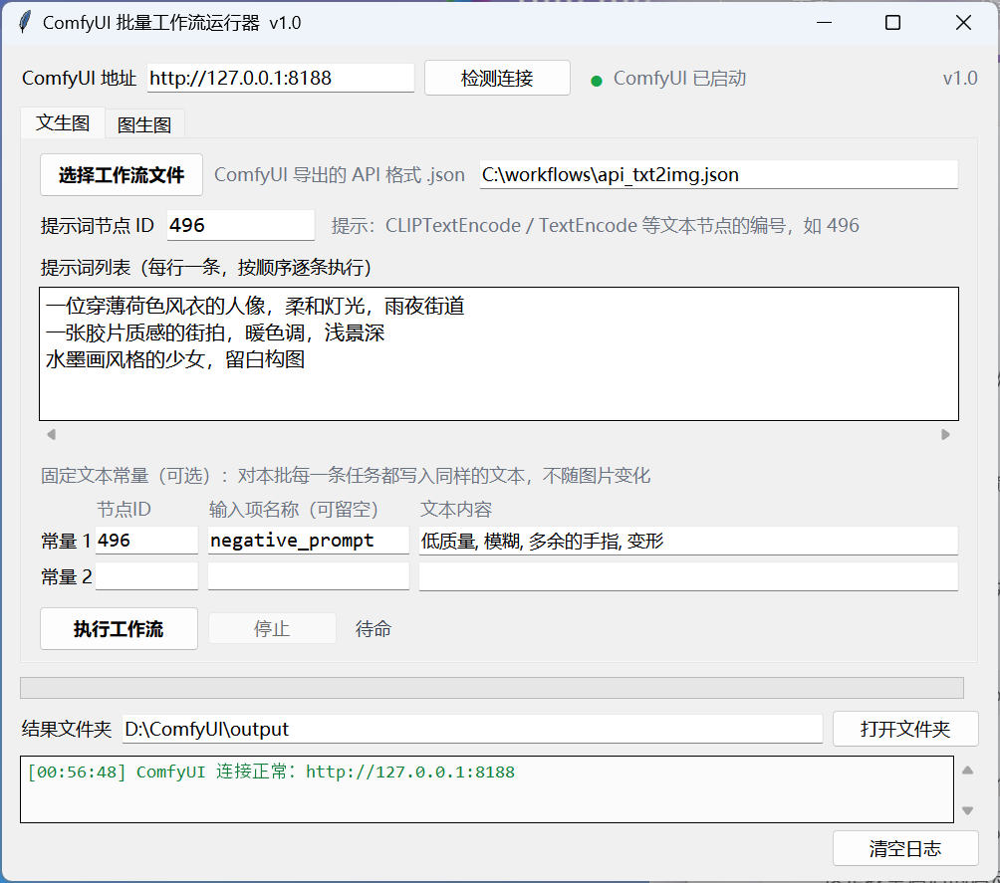
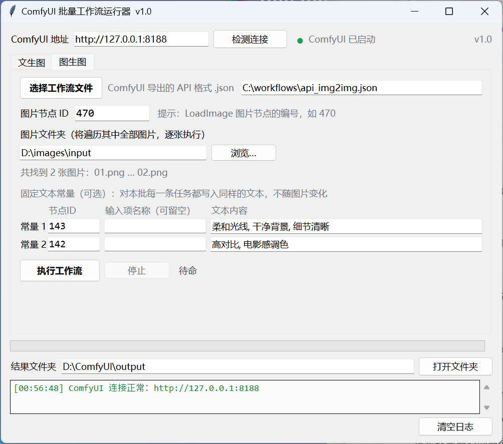

# ComfyUI 批量工作流运行器

一个带图形界面的 Windows 桌面小工具，通过 HTTP API 调用本机 ComfyUI 批量执行工作流。

把提示词一条条排好、把图片丢进一个文件夹，点一次按钮，剩下的交给它。





## 功能

- **文生图页**：载入 API 格式工作流，把提示词框里每一行提示词依次写入指定节点，逐条执行。
- **图生图页**：载入 API 格式工作流，遍历指定目录下的全部图片，逐张上传到 ComfyUI 输入目录并写入指定节点，逐条执行。
- **固定文本常量**：两个标签页都能手动改写工作流里固定不变的文本节点（例如负面提示词）。这些是常量，本批每一条任务都写入同样的内容，不随图片变化。
- **自动识别文本输入项**：不写死 `text` 还是 `prompt`，会在节点里自动找；一个节点有多个文本输入时会提醒你指定。
- **结果直达**：跑完弹窗提示完成，「结果文件夹」直接指向产物实际落盘的目录（SaveImage 常带子目录），一键跳转查看。
- **日志**：实时显示每条任务的提交 / 完成 / 失败，失败写明原因；同时追加写入同目录的 `批量运行日志.log`。
- **中途停止**：单条失败不中断整批；连续 3 条失败自动中止并提示；「停止」按钮可随时叫停。
- **零依赖**：只用 Python 标准库（tkinter + urllib），不需要 pip install 任何东西。

## 运行要求

- Windows
- Python 3.9 或更高版本（安装时勾选 *Add Python to PATH*）
- 本机已启动 ComfyUI，默认地址 `http://127.0.0.1:8188`

不需要安装任何第三方包，`tkinter` 和 `urllib` 都是 Python 自带的。

> **这个仓库只包含这个小程序本身**，ComfyUI 本体（模型、节点、自定义节点等）
> 不在这里，需要你自己安装一套 ComfyUI。本程序只是通过 HTTP API 调用它。
> 本项目与 ComfyUI 官方无关。

## 快速开始

1. 双击 `启动批量工作流运行器.bat`。
2. 在 ComfyUI 里打开你的工作流，用 **「保存（API 格式）」** 导出一个 `.json`。
   注意要选 API 格式，不是普通的可视化工作流文件。
3. 点「选择工作流文件」选中它。选完后底部日志区会列出该工作流的**全部节点编号**，方便你找 ID。
4. 填节点 ID：
   - 文生图：文本节点的编号（`CLIPTextEncode` / `TextEncode` 等）
   - 图生图：图片节点的编号（一般是 `LoadImage`）
5. 文生图把提示词粘贴进提示词框（一行一条）；图生图填上要批量跑图的文件夹。
6. 点「执行工作流」。

程序会先检查 ComfyUI 是否启动，没启动会直接提示，不会空跑。

更多细节见 [`使用说明.txt`](使用说明.txt)。

## 一些实现上的细节

这几个是实际调用 ComfyUI API 时踩到的坑，工具里都已经处理好了：

- **上传图片要自己拼子目录**。ComfyUI 的 `/upload/image` 返回的 `name` 里**不含** subfolder 前缀，
  直接填进 `LoadImage` 会提示找不到文件。本工具上传到 `input/batch/` 后，
  写入节点的是 `batch/xxx.png` 这种完整相对路径。
- **预览图不是产物**。工作流里一堆 `PreviewImage` 节点时，history 会返回二十多条 `type=temp` 的
  临时预览图。只有 `type=output` 的才是真正写进 output 目录的文件，
  本工具只统计后者，并据此推断结果目录。
- **结果目录不一定在 output 根目录**。`SaveImage` 的 `filename_prefix` 常常带子目录，
  比如 `images/qwen/gallery/results`，本工具按实际落盘位置跳转。
- **输出目录靠进程反查**。启动 `ComfyUI/main.py` 的进程会被定位到，
  从而拿到 ComfyUI 根目录和 output 路径；没有 `psutil` 时退回 PowerShell 查询。

## 目录结构

```
comfyui-batch-runner/
├── comfy_batch_runner.py          # 主程序，单文件，纯标准库
├── 启动批量工作流运行器.bat        # 双击启动（Windows）
├── 使用说明.txt                    # 详细操作说明
├── README.md
├── LICENSE                        # MIT
├── requirements.txt               # 空依赖声明
├── .gitignore
├── .gitattributes
└── docs/
    ├── screenshot-txt2img.png
    └── screenshot-img2img.png
```

> 主程序文件名用 ASCII，是为了配合 Windows 的 `.bat` 启动器：
> cmd.exe 按系统 ANSI 代码页（中文系统是 GBK）解析批处理文件，
> 里面出现中文路径会被解析坏。界面和文档仍然全程中文。

运行后会在同目录生成 `批量运行器配置.json`（记住上次的路径和节点 ID）和
`批量运行日志.log`，两者都已加入 `.gitignore`，不会被提交。

## 常见问题

**提示「工作流里没有 ID 为 xxx 的节点」**
选完工作流后日志区会列出所有节点编号，对着填即可。

**提示「节点 xxx 没有名为 xxx 的输入项」**
该节点的输入项名称写错了，日志里会列出它实际有哪些输入项。

**跑完了但找不到图**
看完成弹窗里给的「结果文件夹」和文件名列表。`PreviewImage` 产生的只是预览，
工作流里需要有 `SaveImage` 节点才会真正存盘。

**中文文件名**
上传图片时保留原始文件名，中文名正常工作。

**双击 bat 闪退 / 提示找不到 Python**
装好 Python 3.9+ 并勾选 *Add Python to PATH*。也可以把一个
`python_dapao312` 文件夹放在本程序同级目录下，脚本会优先用它。

## License

MIT
